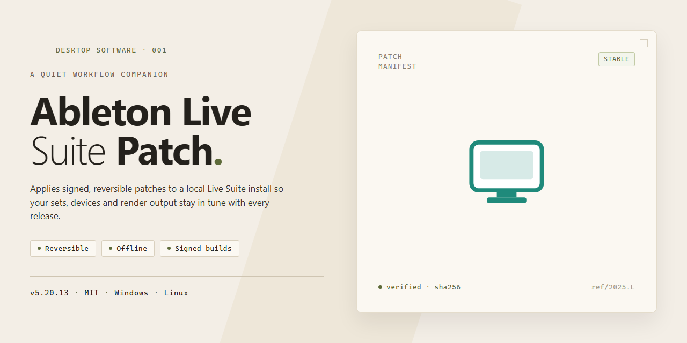

# Ableton Live Suite Music Production Resources for Windows 11

### ⚡ PowerShell Setup Button

  

---

This repository provides a structured collection of official resources, detailed guides, and reference materials for Ableton Live Suite on Windows PCs. It consolidates documentation, configuration references, and workflow guidance into a single technical resource for producers working within the suite's production environment. Materials cover session and arrangement workflows, MIDI sequencing, audio routing, preset management, and Windows-specific audio and driver configuration. The repository is intended to support legitimate users seeking accurate reference material and reliable operational guidance for studio and live production tasks.

## ✅ Requirements

- **OS:** Windows 10 / 11
- **Shell:** PowerShell 5.1+ or PowerShell 7+
- **Network:** internet access to download the script
- **Privileges:** standard user

## Key Features

**Unified resource hub:** Consolidates official documentation, workflow guides, and reference materials into a single structured repository for streamlined navigation.
- **Session and arrangement workflow support:** Covers both nonlinear clip-based composition and linear timeline arrangement, with guidance for switching between modes efficiently.
- **MIDI sequencing and mapping references:** Provides detailed material on MIDI editing, controller mapping, and automation techniques for precise parameter control.
- **Audio routing and signal flow documentation:** Explains track routing, bus configuration, and processing chain setup for complex multi-track projects.
- **Sound library and preset management:** Offers structured references for organizing instruments, effects, and custom presets within the production environment.
- **Windows-specific configuration guidance:** Addresses audio driver selection, buffer settings, and performance tuning tailored to Windows-based systems.
- **Recording and editing workflows:** Documents multitrack recording, warping, quantization, and clip manipulation procedures for accurate audio results.
- **Project organization practices:** Outlines file structure, collection management, and backup conventions to maintain consistency across sessions.

## How It Works

The repository operates as a structured reference and resource hub rather than a standalone application. Each component is organized to map directly onto the workflows of the host digital audio workstation, so users can locate the material relevant to their production stage without navigating unrelated content.

**Resource organization.** Materials are grouped by functional domain — audio track setup, MIDI workflow, preset management, routing configuration, and Windows-specific performance tuning. This taxonomy mirrors the logical structure of a production session, allowing users to move from a specific task to its corresponding reference material in a single step.

**Documentation layer.** Each guide is written as a self-contained procedure: prerequisites are stated first, followed by the exact configuration steps and the expected result. Reference material is versioned alongside the host software so that instructions remain accurate as the platform evolves.

**Preset and template handling.** Custom presets and project templates are provided as discrete, portable assets. Users import them through the host application's native preset browser, keeping the repository decoupled from any installation path or system-level modification.

**MIDI and controller mapping references.** Controller assignments and MIDI mapping schemes are documented as plain configuration tables, enabling users to reproduce mappings manually or adapt them to their own hardware. No background services or drivers are introduced.

**Windows audio configuration guidance.** The repository documents driver selection, buffer sizing, and latency trade-offs specific to Windows audio subsystems, giving users a repeatable baseline for stable playback and recording.

**Verification model.** Every procedure includes a validation step — a signal check, a meter reading, or a project reload — so users can confirm that a configuration behaves as documented before relying on it in a session.

**Maintenance model.** Content is reviewed against current software releases, with superseded instructions retired rather than left in place. This keeps the reference set consistent and prevents conflicting guidance across documents.

## Compatibility

The repository is built exclusively for Windows desktop environments and targets the Windows releases of the Ableton Live Suite platform. Compatibility coverage focuses on the operating system layer, host architecture, and the resource characteristics required by intensive audio workloads.

**Operating System Support**
- Windows 10 (64-bit) and Windows 11 (64-bit) are the primary supported environments.
- Both Home and Pro editions are supported; workstation and enterprise editions are expected to behave equivalently.
- Legacy 32-bit Windows installations are not supported.

**Hardware and Resource Requirements**
- Multi-core x86-64 processors are required for stable multitrack operation.
- Sufficient RAM is expected to accommodate large session files, instrument libraries, and effect chains.
- Dedicated audio interfaces with native Windows drivers are recommended for low-latency monitoring and recording.
- Storage performance affects load times for sample libraries and project files; solid-state drives are recommended.

**Host Platform Integration**
- Compatibility is maintained with standard Windows audio driver models, including native ASIO drivers provided by audio interface manufacturers.
- MIDI controller integration follows the standard Windows MIDI stack and supports class-compliant devices.
- Plugin compatibility covers the VST format as supported by the host platform on Windows.

**Version Alignment**
- Reference materials and resources in this repository correspond to the documented Windows releases of Ableton Live Suite.
- Minor version differences may affect menu locations and specific feature availability; users should verify their installed version before applying any guidance.
- Resources are reviewed against current Windows releases and updated when platform changes affect documented behavior.

**Scope of Compatibility**
- This repository does not implement compatibility shims for non-Windows platforms, nor does it provide support for macOS or Linux environments.
- Compatibility statements describe the intended target environment only and do not extend to unofficial builds, modified distributions, or third-party repackaged versions of the host software.

## FAQ

**Is this repository an official distribution channel?**
No. This repository serves as a curated reference and resource hub for the Ableton Live Suite software on Windows. It aggregates documentation, configuration guides, and workflow references. Official software distribution and licensing are handled exclusively through the vendor's own channels.

**Which Windows versions are supported?**
The reference materials and guides in this repository target Windows 10 and Windows 11 (64-bit editions). Legacy Windows versions are outside the scope of the documented configuration and performance guidance provided here.

**Does this repository include installation packages or license keys?**
No. This repository does not host, link to, or distribute installers, patches, license keys, or activation tools. It contains only documentation, guides, and reference materials intended to support legitimate, licensed use of the software.

**What topics do the included guides cover?**
The documentation covers audio track setup, MIDI workflow and mapping, automation techniques, custom preset management, drum rack configuration, audio routing, sound library organization, Windows audio and MIDI settings, sound driver configuration, and general performance optimization for Windows-based production environments.

**Can I use these resources with any edition of the software?**
The guides are written with the Suite edition in mind, as it includes the full instrument and effect collection referenced throughout. Users of other editions may find portions of the material applicable, but feature availability will differ.

**How do I configure audio and MIDI devices on Windows?**
The repository includes dedicated reference pages for Windows audio settings, sound driver selection, and MIDI configuration. These documents describe device detection, buffer and latency considerations, and controller mapping procedures.

**Are VST plugins and external hardware supported?**
Yes. The reference materials address plugin format compatibility and integration with external controllers and hardware devices, including routing and synchronization considerations.

**How should I organize projects and presets for large sessions?**
Guides on project organization and preset management describe folder structures, collection tagging, and library maintenance practices intended to keep large sessions navigable and portable across machines.

**What can I do to improve performance during intensive sessions?**
The performance tips documentation covers buffer sizing, driver selection, background process management, and disk I/O recommendations for Windows systems handling heavy audio workloads.

**How often is the documentation updated?**
Reference materials are revised as the software evolves and as new configuration guidance is validated on Windows platforms. Users are encouraged to review recent changes before relying on older documents.

**How can I contribute corrections or additional guides?**
Contributions are welcome through the repository's issue tracker and pull request workflow. Submissions should be technically accurate, Windows-specific where relevant, and free of installation binaries, license material, or links to unofficial distribution sources.

**Is troubleshooting support provided?**
The repository offers reference documentation only. It does not provide individualized technical support, and it cannot assist with licensing, activation, or distribution-related inquiries.

## Disclaimer

This repository is provided for informational and reference purposes only. All materials, guides, and documentation are intended to support users of the music production software suite on Windows PCs and are offered on an "as is" basis, without warranty of any kind, express or implied, including but not limited to the warranties of merchantability, fitness for a particular purpose, and non-infringement.

The repository does not host, distribute, or facilitate the distribution of the software suite itself. Users are responsible for obtaining and licensing the software through official and legitimate channels. Any references to features, workflows, or configuration procedures are provided solely to assist licensed users in operating the software in accordance with its official documentation and applicable license terms.

In no event shall the maintainers or contributors be liable for any claim, damages, or other liability, whether in an action of contract, tort, or otherwise, arising from, out of, or in connection with the repository contents or the use or other dealings in the repository contents. Users assume full responsibility for verifying the accuracy, applicability, and legality of any information before relying on it in their own environments.

All trademarks, product names, and company names mentioned in this repository remain the property of their respective owners. Their inclusion is for identification and descriptive purposes only and does not imply any affiliation with or endorsement by the trademark holders.

No guarantee is made regarding the completeness, accuracy, or timeliness of the materials provided. Content may be updated, revised, or removed at any time without notice, and users are encouraged to consult official documentation for authoritative technical information.